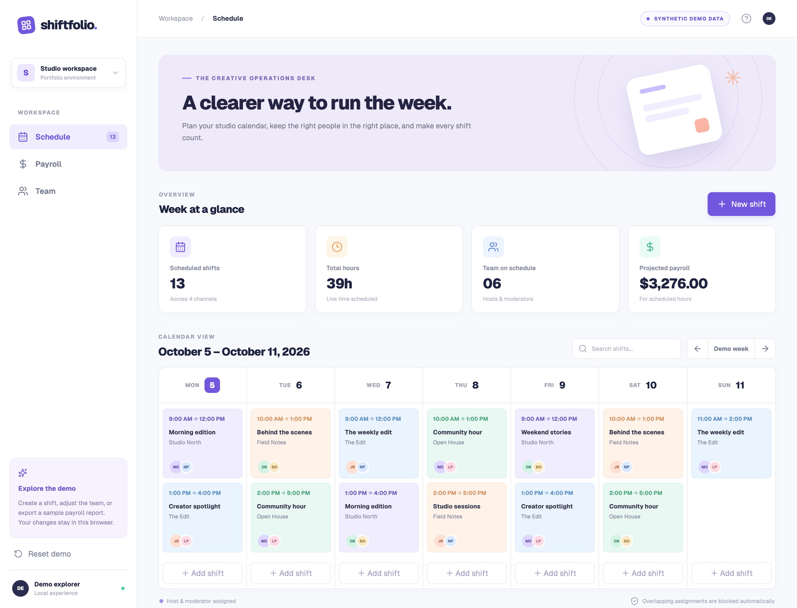
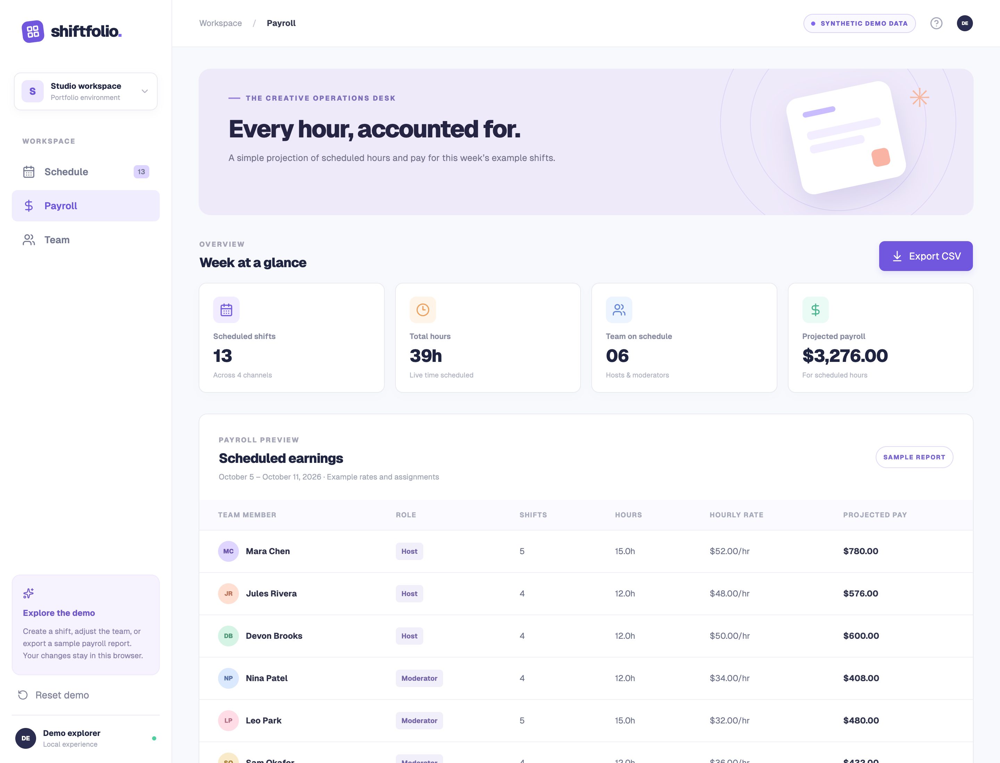

# Shiftfolio

[](https://github.com/amugin-stack/shiftfolio/actions/workflows/ci.yml)

Shiftfolio is an interactive, offline portfolio demonstration of a staff scheduling workflow. It uses fictional people, studio channels, shifts, and pay rates. The demo runs locally without an account, database, or API keys.

## Try the demo

Use Node.js 24 and npm:

```bash
npm ci
npm run dev
```

Open [http://localhost:3000](http://localhost:3000). No `.env` file is needed. The sample opens on the week of October 5, 2026 so the schedule and exports are reproducible.

Create, edit, or delete a shift in **Schedule**. Assign a host and moderator; overlapping assignments are blocked. **Payroll** recalculates projected pay from the current shifts and downloads a sample CSV. **Team** shows the fictional roster. Changes are stored in this browser's local storage. **Reset demo** restores the original sample shifts and week.

## Check the project

```bash
npm test
npm run lint
npm run build
npm run scan:privacy
```

The project uses Next.js 15, React 19, TypeScript, Tailwind CSS, and selected scheduling and pay helpers from the original codebase. The live demo uses a custom weekly calendar; retained FullCalendar views are reference code, not active demo routes. See [Architecture](docs/ARCHITECTURE.md), the [roadmap](docs/ROADMAP.md), and [local verification](docs/VERIFICATION.md).

## Boundaries

This is a planning example, not an operational scheduling or payroll service. It does not authenticate users, send messages, connect to a production database, or calculate a real person's pay. The original application routes and supporting source are retained as reference material outside the active route tree. The original production deployment and configuration are outside this repository.




